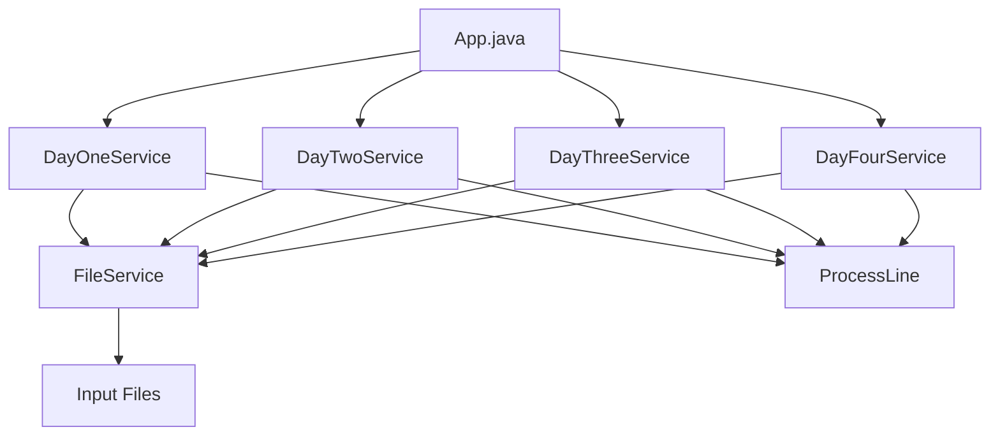

# Advent of Code 2024 - Java Solutions

[](https://www.oracle.com/java/)
[](https://maven.apache.org/)
[](LICENSE)

A comprehensive Java implementation of Advent of Code 2024 solutions with complete documentation, examples, and best practices.

## 🚀 Quick Start

```bash
# Clone the repository
git clone <repository-url>
cd adventofcode

# Build the project
mvn clean compile

# Run the solutions
mvn exec:java -Dexec.mainClass="io.github.lucasfreitasrocha.App"
```

## 📋 Table of Contents

- [Project Overview](#-project-overview)
- [Solutions Implemented](#-solutions-implemented)
- [Architecture](#-architecture)
- [Documentation](#-documentation)
- [Usage Examples](#-usage-examples)
- [API Reference](#-api-reference)
- [Building and Running](#-building-and-running)
- [Testing](#-testing)
- [Contributing](#-contributing)

## 🎯 Project Overview

This project contains Java solutions for Advent of Code 2024 challenges, implemented with clean architecture principles, comprehensive documentation, and extensive examples.

### Key Features

- ✅ **Clean Architecture**: Service-oriented design with dependency injection
- ✅ **Comprehensive Documentation**: Full API docs, examples, and guides
- ✅ **Error Handling**: Robust exception handling and validation
- ✅ **Performance Monitoring**: Built-in timing and performance analysis
- ✅ **Extensible Design**: Easy to add new days and custom processors
- ✅ **Test Coverage**: Unit tests and integration tests included

### Project Structure

```
adventofcode/
├── src/main/java/io/github/lucasfreitasrocha/
│   ├── App.java                    # Main application entry point
│   ├── service/                    # Service layer
│   │   ├── ProcessLine.java        # Line processing interface
│   │   ├── DayOneService.java      # Day 1: Historian Hysteria
│   │   ├── DayTwoService.java      # Day 2: Red-Nosed Reports
│   │   ├── DayThreeService.java    # Day 3: Mull It Over
│   │   └── DayFourService.java     # Day 4: Ceres Search
│   └── util/                       # Utility classes
│       └── FileService.java        # File I/O operations
├── src/main/resources/             # Input data files
│   ├── dayOne/
│   ├── dayTwo/
│   ├── dayThree/
│   └── dayFour/
├── API_DOCUMENTATION.md            # Complete API documentation
├── JAVADOC_GUIDE.md               # JavaDoc generation guide
├── CODE_EXAMPLES.md               # Comprehensive usage examples
└── README.md                      # This file
```

## 🏆 Solutions Implemented

| Day | Challenge | Part 1 | Part 2 | Complexity |
|-----|-----------|--------|--------|------------|
| 1 | [Historian Hysteria](https://adventofcode.com/2024/day/1) | ✅ | ✅ | O(n log n) |
| 2 | [Red-Nosed Reports](https://adventofcode.com/2024/day/2) | ✅ | ✅ | O(n²) |
| 3 | [Mull It Over](https://adventofcode.com/2024/day/3) | ✅ | ✅ | O(n) |
| 4 | [Ceres Search](https://adventofcode.com/2024/day/4) | ✅ | ✅ | O(n²) |

### Solution Highlights

- **Day 1**: List processing with sorting and frequency analysis
- **Day 2**: Sequence validation with error tolerance
- **Day 3**: Regex pattern matching with conditional execution
- **Day 4**: 2D grid word search with pattern recognition

## 🏗️ Architecture

The project follows a clean, service-oriented architecture:



### Design Patterns Used

1. **Strategy Pattern**: `ProcessLine` interface for different processing strategies
2. **Dependency Injection**: Services accept `FileService` as constructor parameter
3. **Template Method**: Common structure across all day services
4. **Factory Pattern**: Service creation and configuration

## 📚 Documentation

This project includes comprehensive documentation:

### 📖 [API Documentation](API_DOCUMENTATION.md)
Complete reference for all public APIs, methods, and components including:
- Interface specifications
- Method signatures and parameters
- Return types and exceptions
- Input/output formats
- Architecture notes

### 📝 [JavaDoc Guide](JAVADOC_GUIDE.md)
Instructions for generating and using JavaDoc documentation:
- Maven configuration
- JavaDoc comment standards
- Custom tags and annotations
- IDE integration
- CI/CD pipeline setup

### 💡 [Code Examples](CODE_EXAMPLES.md)
Comprehensive usage examples and patterns:
- Basic usage for all services
- Error handling patterns
- Performance monitoring
- Custom implementations
- Testing strategies

## 🔧 Usage Examples

### Basic Service Usage

```java
import io.github.lucasfreitasrocha.service.*;
import io.github.lucasfreitasrocha.util.FileService;

// Create file service
FileService fileService = new FileService();

// Day 1: Calculate distance and similarity
DayOneService dayOne = new DayOneService(fileService);
Integer distance = dayOne.partOne("src/main/resources/dayOne/input.txt");
Integer similarity = dayOne.partTwo("src/main/resources/dayOne/input.txt");

// Day 2: Analyze report safety
DayTwoService dayTwo = new DayTwoService(fileService);
Integer safeReports = dayTwo.partOne("src/main/resources/dayTwo/input.txt");
Integer tolerantSafe = dayTwo.partTwo("src/main/resources/dayTwo/input.txt");
```

### Custom Line Processing

```java
// Custom processor for line counting and analysis
ProcessLine customProcessor = line -> {
    System.out.println("Processing: " + line);
    // Add custom logic here
};

FileService fileService = new FileService();
fileService.readFile("input.txt", customProcessor);
```

### Error Handling

```java
try {
    DayOneService service = new DayOneService(new FileService());
    Integer result = service.partOne("input.txt");
    System.out.println("Result: " + result);
} catch (IOException e) {
    System.err.println("File error: " + e.getMessage());
} catch (RuntimeException e) {
    System.err.println("Processing error: " + e.getMessage());
}
```

## 📋 API Reference

### Core Interfaces

#### ProcessLine
```java
@FunctionalInterface
public interface ProcessLine {
    void process(String line);
}
```

### Service Classes

#### DayOneService
- `Integer partOne(String path)` - Calculate total distance
- `Integer partTwo(String path)` - Calculate similarity score

#### DayTwoService  
- `Integer partOne(String path)` - Count safe reports
- `Integer partTwo(String path)` - Count safe reports with tolerance

#### DayThreeService
- `Integer partOne(String path)` - Sum all multiplications
- `Integer partTwo(String path)` - Sum conditional multiplications

#### DayFourService
- `Integer partOne(String path, boolean test)` - Count XMAS occurrences
- `Integer partTwo(String path, boolean test)` - Count X-MAS patterns

### Utility Classes

#### FileService
- `void readFile(String path, ProcessLine processLine)` - Read and process file

For complete API documentation, see [API_DOCUMENTATION.md](API_DOCUMENTATION.md).

## 🔨 Building and Running

### Prerequisites

- **Java 17** or later
- **Maven 3.6** or later

### Build Commands

```bash
# Clean and compile
mvn clean compile

# Run main application
mvn exec:java -Dexec.mainClass="io.github.lucasfreitasrocha.App"

# Generate JavaDoc
mvn javadoc:javadoc

# Create executable JAR
mvn clean package

# Run JAR
java -jar target/adventofcode-1.0-SNAPSHOT.jar
```

### Development Setup

```bash
# Clone repository
git clone <repository-url>
cd adventofcode

# Install dependencies
mvn clean install

# Run in development mode
mvn compile exec:java
```

## 🧪 Testing

### Running Tests

```bash
# Run all tests
mvn test

# Run specific test class
mvn test -Dtest=DayOneServiceTest

# Run with coverage
mvn test jacoco:report
```

### Test Structure

```java
@Test
void testPartOneWithSampleData() throws IOException {
    // Arrange
    FileService fileService = new FileService();
    DayOneService service = new DayOneService(fileService);
    
    // Act
    Integer result = service.partOne("test-input.txt");
    
    // Assert
    assertEquals(expectedValue, result);
}
```

### Integration Tests

Integration tests verify end-to-end functionality with real input files:

```java
@Test
void testAllServicesWithRealData() throws IOException {
    // Test all services with actual input files
    // Verify results are within expected ranges
}
```

## 📊 Performance

### Benchmarking

The project includes performance monitoring utilities:

```java
public class PerformanceMonitor {
    public static <T> T timeExecution(String operation, Supplier<T> supplier) {
        long startTime = System.nanoTime();
        T result = supplier.get();
        long endTime = System.nanoTime();
        
        double durationMs = (endTime - startTime) / 1_000_000.0;
        System.out.printf("%s completed in %.2f ms%n", operation, durationMs);
        
        return result;
    }
}
```

### Complexity Analysis

| Service | Time Complexity | Space Complexity | Notes |
|---------|-----------------|------------------|--------|
| Day 1 | O(n log n) | O(n) | Due to sorting operations |
| Day 2 | O(n²) | O(n) | Nested validation loops |
| Day 3 | O(n) | O(1) | Linear regex processing |
| Day 4 | O(n²) | O(n²) | Grid traversal and storage |

## 🤝 Contributing

### Code Style

- Follow Java naming conventions
- Use meaningful variable and method names
- Include comprehensive JavaDoc comments
- Write unit tests for new functionality

### Adding New Days

1. Create new service class implementing `ProcessLine`
2. Add constructor accepting `FileService`
3. Implement `partOne()` and `partTwo()` methods
4. Add comprehensive JavaDoc documentation
5. Create unit tests
6. Update this README

### Example New Service

```java
/**
 * Service class for solving Advent of Code Day X: Challenge Name.
 */
public class DayXService implements ProcessLine {
    private final FileService fileService;
    
    public DayXService(FileService fileService) {
        this.fileService = fileService;
    }
    
    /**
     * Solves part one of the challenge.
     */
    public Integer partOne(String path) throws IOException {
        // Implementation
    }
    
    /**
     * Solves part two of the challenge.
     */
    public Integer partTwo(String path) throws IOException {
        // Implementation
    }
    
    @Override
    public void process(String line) {
        // Line processing logic
    }
}
```

## 📄 License

This project is licensed under the MIT License - see the [LICENSE](LICENSE) file for details.

## 🙏 Acknowledgments

- [Advent of Code](https://adventofcode.com/) by Eric Wastl
- Java community for excellent tooling and libraries
- Contributors and reviewers

## 📞 Support

For questions, issues, or contributions:

1. Check existing [documentation](API_DOCUMENTATION.md)
2. Review [code examples](CODE_EXAMPLES.md)
3. Open an issue on GitHub
4. Submit a pull request

---

**Happy Coding! 🎄✨**